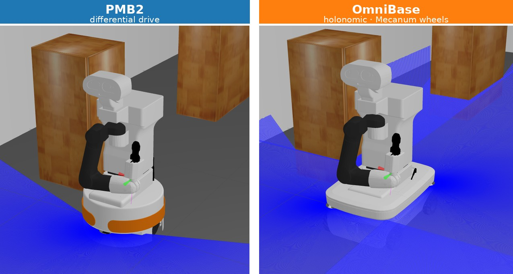
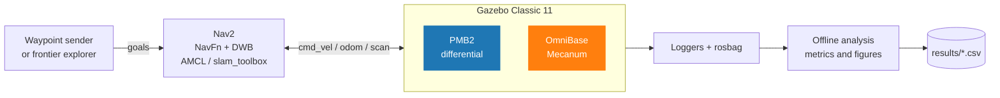
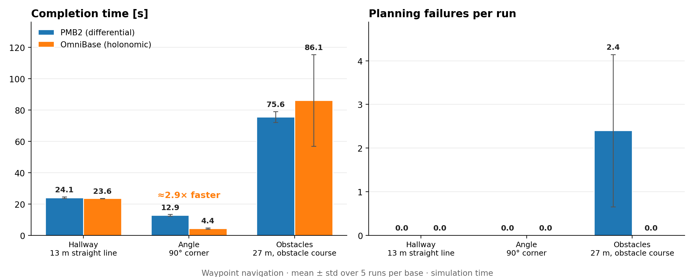
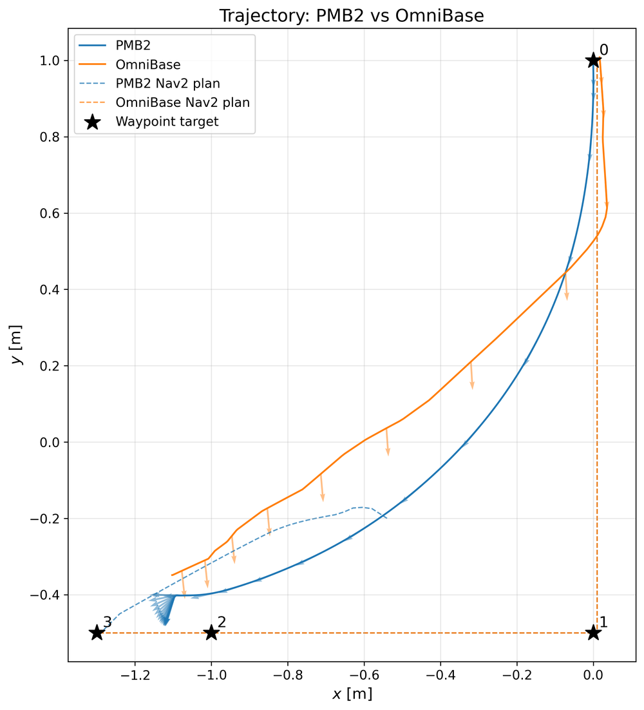
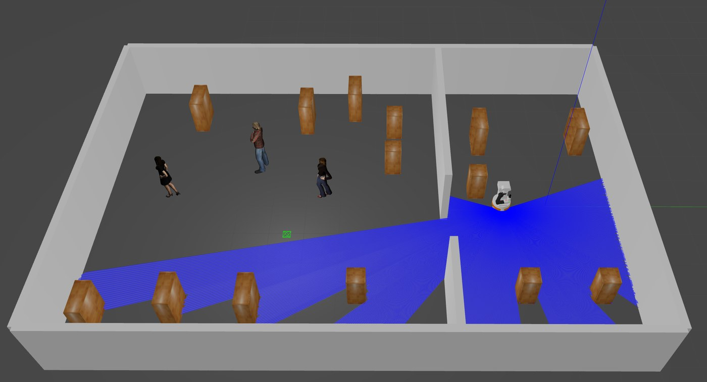
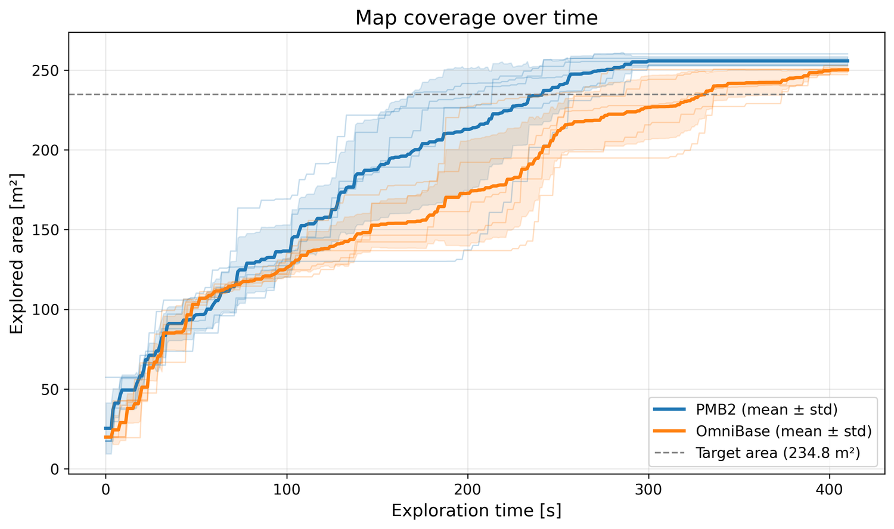
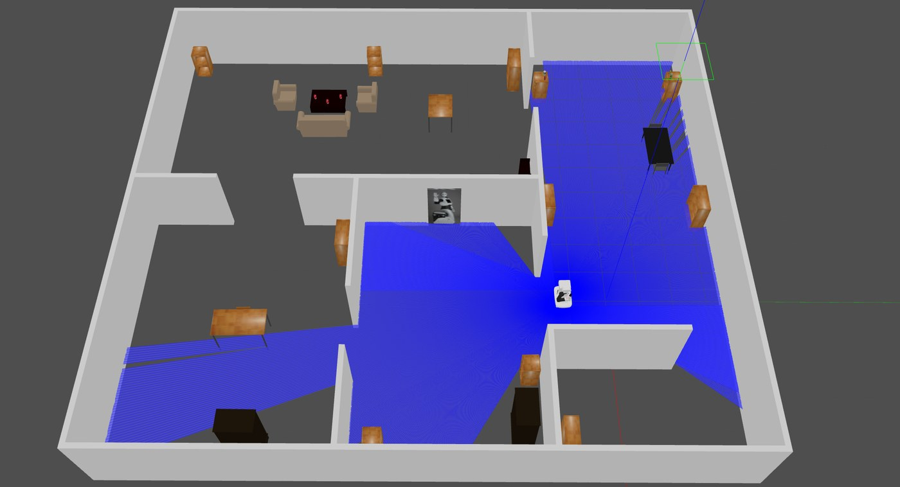

<div align="center">

# ROS 2 Nav2: Differential vs Holonomic Drives

**Autonomous Navigation Strategies for Mobile Robots in ROS 2:<br/>A Comparative Study of Differential and Holonomic Drives**




[📄 Thesis PDF](thesis/thesis.pdf) · [📊 Results](#-main-results) · [🧪 Reproduce](#-reproducing-the-work) · [📁 Structure](#-repository-structure)

</div>

---

Code, data and LaTeX source of my thesis in Automation Engineering at the **University of Bologna** (supervisor: Prof. Alessio Caporali).

The thesis compares two PAL Robotics TIAGo mobile bases under the **same Nav2 stack**, in simulation, on two tasks: **waypoint navigation** and **autonomous frontier-based exploration**.

| | 🔵 PMB2 | 🟠 OmniBase |
|---|---|---|
| Kinematics | Differential drive | Holonomic, 4 Mecanum wheels |
| Gazebo actuation | `ros2_control` (wheel dynamics) | `gazebo_ros_planar_move` (ideal, slip-free) |
| Planners | NavFn + DWB | NavFn + DWB |
| Goal tolerances | `xy` = `yaw` = 0.25 | `xy` = `yaw` = 0.25 |

Both bases share the same speed cap (1 m/s), the same `RotateToGoal` settings and `velocity_smoother` in open-loop mode. Every configuration is run **5 times per base** and reported as mean ± standard deviation. All timing metrics use **simulation time**, so they do not depend on the real-time factor.



## 📊 Main results

<div align="center">

</div>

<br/>

| Scenario | Metric | 🔵 PMB2 | 🟠 OmniBase |
|---|---|---|---|
| **Hallway** (13 m straight line) | Completion time | 24.1 ± 0.5 s | 23.6 ± 0.1 s |
| | Lateral velocity usage | 0.00 | 0.08 |
| **Angle** (short path, 90° corner) | Completion time | 12.9 ± 0.6 s | **4.4 ± 0.4 s** |
| | Lateral velocity usage | 0.00 | 0.67 |
| **Obstacles** (27 m, obstacle course) | Completion time | 75.6 ± 3.5 s | 86.1 ± 29.3 s |
| | Planning failures per run | 2.4 ± 1.7 | 0.0 |

- 🏁 **The holonomic advantage appears where Nav2 actually commands lateral motion.** On the straight hallway the two bases are equivalent, while at the corner the OmniBase is about **2.9× faster**.
- ✅ **The OmniBase had no planning failures** in the reported runs. The PMB2 failures grow with scenario difficulty: 0 (Hallway), 0 (Angle), 2.4 (Obstacles), 32.4 per run in exploration.
- ⚖️ **In the obstacle course there is no clear time advantage**: the OmniBase mean is higher and much more variable (± 29.3 s).
- 🗺️ **In exploration the OmniBase was slower overall.** The cause is its rectangular footprint combined with a rotation-averse tuning, which makes U-turns along walls slow, not a difference in raw speed.

<table>
<tr>
<td align="center" width="42%"></td>
<td align="center" width="58%"></td>
</tr>
<tr>
<td><sub><b>Sharp corner.</b> Median run of each base: the OmniBase translates diagonally with a nearly constant heading (arrows), the PMB2 follows a curved path and rotates in place near the end.</sub></td>
<td><sub><b>Waypoint campaign world.</b> Modified <code>small_office</code> populated with static obstacles and human models, used for all three waypoint scenarios.</sub></td>
</tr>
</table>

<table>
<tr>
<td align="center" width="62%"></td>
<td align="center" width="38%"></td>
</tr>
<tr>
<td><sub><b>Autonomous exploration.</b> Explored area over time (mean ± std, 5 runs per base): the PMB2 reaches the target area earlier.</sub></td>
<td><sub><b>Exploration world.</b> The unaltered PAL <code>home</code> apartment.</sub></td>
</tr>
</table>

Full tables, all figures and the discussion are in the [thesis](thesis/thesis.pdf).

## ⚠️ Methodological caveats

> [!IMPORTANT]
> **Actuation fidelity is asymmetric.** The OmniBase is moved by the idealized `gazebo_ros_planar_move` plugin, which imposes `vx, vy, wz` directly on the body (no slip, no wheel dynamics), while the PMB2 uses `ros2_control`. Part of the OmniBase advantage may therefore be optimistic with respect to a real Mecanum platform.

- **Wheel data are reconstructed.** On the PMB2 the wheel velocities are `NaN` in simulation (a known `ros2_control` limitation) and are derived numerically from positions. On the OmniBase the wheels are reconstructed with inverse Mecanum kinematics from `cmd_vel` (ideal, no slip).
- **Simulation is not deterministic.** Gazebo, `slam_toolbox` and Nav2 produce different runs even with identical settings, which is why each condition is repeated 5 times.
- **Scenarios are limited.** Waypoint tests run in one office world and exploration in one apartment world. A larger environment would probably accentuate the differences.

## 📁 Repository structure

```
.
├── thesis/                    LaTeX source (main.tex, chapters/, appendices/, images/, .bib) and thesis.pdf
├── workspace/
│   ├── tiago_ws.repos         Pinned upstream repositories of the TIAGo workspace
│   ├── ros2_ws.repos          Pinned ros-controls repositories (underlay)
│   ├── overlay/               Only the files I modified or added, same folder layout as src/
│   └── REMOVED.txt            Packages removed before building
├── launch/
│   └── tiago_thesis_gazebo.launch.py   Spawns TIAGo (base_type, world_name, x, y, yaw)
├── scripts/
│   ├── waypoint_navigation/   send_waypoints, metrics_logger, bt_counts_from_bag, aggregate_waypoints, analyze_results
│   ├── exploration/           autonomous_explorer, exploration_logger, bt_counts_from_bag, analyze_exploration
│   └── tools/                 odom_tf_publisher, check_slip, plot_csv
├── waypoints/                 waypoints_hallway.yaml, waypoints_angle.yaml, waypoints_obs.yaml
├── maps/small_office_map/     Map used for AMCL in the waypoint scenarios
├── results/                   summary_Hallway.csv, summary_Angle.csv, summary_Obs.csv
└── docs/images/               Images used in this README
```

The full TIAGo workspace is **not** copied here. It is rebuilt from the pinned upstream repositories in `workspace/*.repos`, plus the modified files in `workspace/overlay/`. The two Nav2 parameter files at the core of the comparison are:

- [`pmb2_nav2.yaml`](workspace/overlay/pal_navigation_cfg_public/pal_navigation_cfg_params/params/pmb2_nav2.yaml)
- [`omni_base_nav2.yaml`](workspace/overlay/pal_navigation_cfg_public/pal_navigation_cfg_params/params/omni_base_nav2.yaml)

## 🧪 Reproducing the work

**Requirements:** Ubuntu 22.04, ROS 2 Humble (desktop), Gazebo Classic 11 with `gazebo_ros_pkgs`, Nav2 (including `nav2_simple_commander`), `slam_toolbox`, `colcon`, `rosdep` and `vcstool`. The analysis scripts also need `python3` with `numpy`, `pandas`, `matplotlib` and `pyyaml`.

<details>
<summary><b>1. Build the workspaces</b></summary>

<br/>

```bash
git clone https://github.com/andreagallo-dev/ros2-nav2-differential-vs-holonomic.git
cd ros2-nav2-differential-vs-holonomic
export THESIS_REPO=$PWD
source /opt/ros/humble/setup.bash
```

Underlay (`ros2_control` stack, pinned commits):

```bash
mkdir -p ~/ros2_ws
vcs import ~/ros2_ws < $THESIS_REPO/workspace/ros2_ws.repos
rm -rf ~/ros2_ws/src/ros-controls/ros2_controllers/rqt_joint_trajectory_controller
cd ~/ros2_ws && rosdep install --from-paths src --ignore-src -r -y && colcon build --symlink-install
source ~/ros2_ws/install/setup.bash
```

TIAGo workspace (base snapshot + pinned PAL packages + my modifications):

```bash
git clone https://github.com/ljuba1996/TiagoWorkspace.git ~/tiago_ws/src
git -C ~/tiago_ws/src checkout 3928817
rm -rf ~/tiago_ws/src/play_motion2 ~/tiago_ws/src/pal_urdf_utils
vcs import --skip-existing ~/tiago_ws < $THESIS_REPO/workspace/tiago_ws.repos
cp -r $THESIS_REPO/workspace/overlay/. ~/tiago_ws/src/
cd ~/tiago_ws && rosdep install --from-paths src --ignore-src -r -y && colcon build --symlink-install
source ~/tiago_ws/install/setup.bash
```

`pal_urdf_utils` is removed because the snapshot only contains a partial copy: the complete package is cloned at the pinned commit by `vcs import`. `play_motion2` is removed as listed in `workspace/REMOVED.txt`. The paths in the `.repos` files are relative to the workspace root, which is why `vcs import` targets `~/ros2_ws` and `~/tiago_ws`, not their `src` folders.

</details>

<details>
<summary><b>2. Waypoint navigation (one run)</b></summary>

<br/>

Use `base_type:=pmb2` or `base_type:=omni_base` in the launch files, and `--base-type pmb2` or `--base-type omni` in the scripts. The spawn pose is the first waypoint of the scenario file (for Hallway: `x:=1.245 y:=1.620 yaw:=-1.5708`).

```bash
# Terminal 1: Gazebo
ros2 launch $THESIS_REPO/launch/tiago_thesis_gazebo.launch.py base_type:=pmb2 world_name:=small_office x:=1.245 y:=1.620 yaw:=-1.5708

# Terminal 2: Nav2 + AMCL on the saved map
ros2 launch tiago_2dnav tiago_nav_bringup.launch.py base_type:=pmb2 is_public_sim:=false rviz:=True slam:=False use_sim_time:=True map_path:=$THESIS_REPO/maps/small_office_map
```

Set the initial pose to the spawn pose (RViz *2D Pose Estimate*, or publish on `/initialpose`) and wait for AMCL to settle. Then:

```bash
# Terminal 3: rosbag
ros2 bag record -o bags/pmb2_A_rep1 /gazebo/model_states /cmd_vel /joint_states /plan /tf /tf_static /behavior_tree_log

# Terminal 4: metrics logger, started right before the waypoints
python3 $THESIS_REPO/scripts/waypoint_navigation/metrics_logger.py --base-type pmb2 --run-id A_rep1 --model-name tiago --out-dir ./logs --ros-args -p use_sim_time:=true

# Terminal 5: waypoint sequence
python3 $THESIS_REPO/scripts/waypoint_navigation/send_waypoints.py --waypoints $THESIS_REPO/waypoints/waypoints_hallway.yaml --base-type pmb2 --run-id A_rep1 --out-dir ./logs --ros-args -p use_sim_time:=true
```

Each run writes `logs/<base>_<run-id>/` (including `log.csv`). Scenario letters in the run ids: `A` = Hallway, `B` = Angle, `C` = Obstacles.

</details>

<details>
<summary><b>3. Autonomous exploration (one run)</b></summary>

<br/>

Gazebo and the Nav2 bringup are restarted completely between runs, so that the SLAM map and the explorer blacklist start from scratch.

```bash
ros2 launch $THESIS_REPO/launch/tiago_thesis_gazebo.launch.py base_type:=pmb2 world_name:=home
ros2 launch tiago_2dnav tiago_nav_bringup.launch.py base_type:=pmb2 is_public_sim:=false rviz:=True slam:=True use_sim_time:=True
ros2 bag record -o bags/pmb2_expl_rep1 /gazebo/model_states /cmd_vel /joint_states /map /plan /tf /tf_static /behavior_tree_log /exploration_status
python3 $THESIS_REPO/scripts/exploration/exploration_logger.py --base-type pmb2 --run-id expl_rep1 --model-name tiago --out-dir ./logs_explore --ros-args -p use_sim_time:=true
python3 $THESIS_REPO/scripts/exploration/autonomous_explorer.py --base-type pmb2 --run-id expl_rep1 --out-dir ./logs_explore --policy nearest --goal-clearance 0.55 --goal-retract 0.40 --blacklist-radius 1.0 --frontier-threshold 10 --max-nav-time 20 --ros-args -p use_sim_time:=true
```

</details>

<details>
<summary><b>4. Analysis</b></summary>

<br/>

Recovery and planning counters are extracted offline from the rosbag with `bt_counts_from_bag.py`. The version in `waypoint_navigation/` and the one in `exploration/` are different scripts with the same name, so do not swap them. `aggregate_waypoints.py` imports `analyze_results.py`, so keep them in the same folder.

```bash
cd $THESIS_REPO/scripts/waypoint_navigation
python3 aggregate_waypoints.py --pmb2-run-dirs logs/pmb2_A_rep* --omni-run-dirs logs/omni_A_rep* --waypoints $THESIS_REPO/waypoints/waypoints_hallway.yaml --label Hallway --out-dir figures_wp/hallway

cd $THESIS_REPO/scripts/exploration
python3 analyze_exploration.py --pmb2-run-dirs logs_explore/pmb2_expl_rep* --omni-run-dirs logs_explore/omni_expl_rep* --out-dir figures_explore
```

`aggregate_waypoints.py` prints mean ± std for every metric, writes `summary_<label>.csv` and suggests the median pair of runs to feed to `analyze_results.py` for the per-run figures.

</details>

<details>
<summary><b>Known issues</b></summary>

<br/>

- **AMD GPUs:** with Gazebo Classic and Mesa, the GPU lidar can return `-inf`. The thesis runs used software rendering for `gzserver` only, applied identically to both bases.
- **OmniBase launch log:** the launch tries to spawn a `diff_drive_controller` meant for the PMB2. The error is harmless, because the OmniBase is driven by `gazebo_ros_planar_move`.

</details>

## 🗂️ Result files

`results/summary_<Scenario>.csv` has one row per run (10 per file, 5 per base). Main columns: `base`, `run`, `completed`, `duration_s`, `path_length_m`, tracking errors against the Nav2 plan (`track_err_*`), waypoint position/yaw errors (`wp_*`), smoothness (`smooth_ang`, `smooth_lin`), `lateral_usage`, `avg_speed_mps`, recovery counters (`spins`, `backups`, `waits`, `costmap_clears`), planning (`replans`, `plan_failures`, `plan_fail_rate`) and `rtf`.

## 📜 License and credits

- Code in this repository: **MIT** (see [LICENSE](LICENSE)).
- Files in `workspace/overlay/` derive from PAL Robotics packages and keep their original Apache-2.0 licenses and headers.
- Thesis text and figures in `thesis/` and `docs/images/`: all rights reserved by the author.
- Built on [PAL Robotics](https://pal-robotics.com/) TIAGo, [Nav2](https://nav2.org/), [ros2_control](https://control.ros.org/) and [slam_toolbox](https://github.com/SteveMacenski/slam_toolbox).

## 📚 Citation

```bibtex
@thesis{gallo2026navigation,
  author = {Andrea Gallo},
  title  = {Autonomous Navigation Strategies for Mobile Robots in {ROS} 2: A Comparative Study of Differential and Holonomic Drives},
  school = {University of Bologna},
  year   = {2026}
}
```
